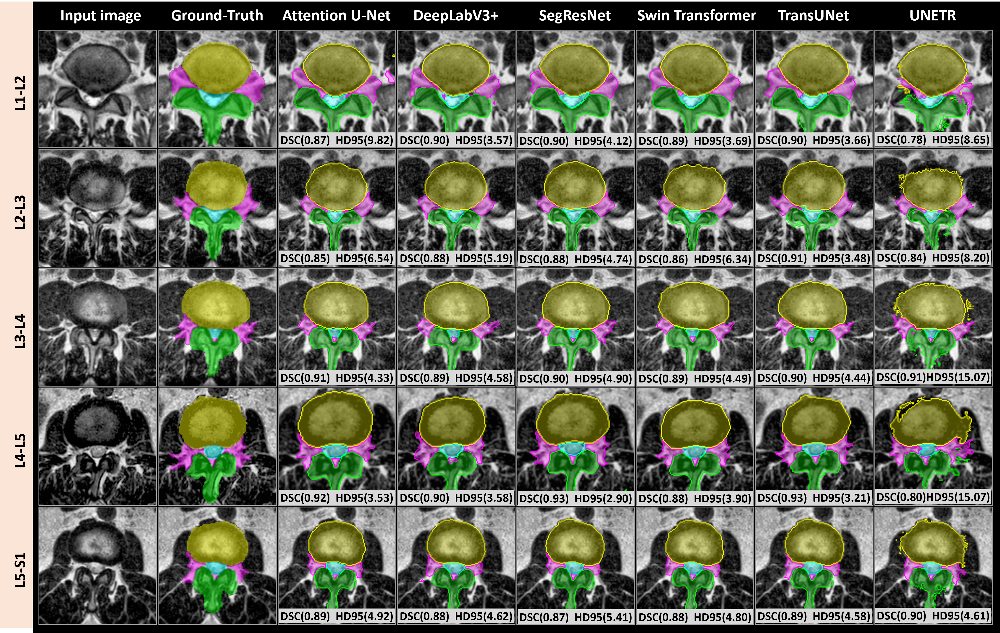

# LSS-Axial-MRI-AISSLab-Dataset

## 🧠 Lumbar Spine MRI Technical Validation

This repository contains the source code used for the **technical validation** of the **Medical Lumbar Spine 3D Axial MRI Dataset for Anatomical Segmentation, Localization, and Stenosis Severity Classification**. The implemented pipelines provide reproducible experiments for **anatomical segmentation**, **ROI localization**, and **stenosis severity classification** on lumbar spine axial MRI.


### 📊 Anatomical Segmentation Performance

**Table 3.** Average quantitative evaluation of anatomical segmentation performance across the proposed axial lumbar spine MRI dataset.

| Class | Dice | IoU | HD95 | ASSD | Pre | Rec | Spe | Accu | Parameters (Million) | FLOPs (G) | FPS |
|:------|-----:|----:|-----:|-----:|----:|----:|----:|-----:|---------------------:|----------:|----:|
| DeepLabv3 | 86.88 | 79.04 | 4.83 | 1.42 | 88.13 | 87.85 | 98.07 | 99.35 | 39.63 | 62.66 | 169.8 |
| AttentionUnet | 87.59 | 80.01 | 5.42 | 1.50 | 90.18 | 87.30 | 98.01 | 99.36 | 1.99 | 4.13 | 236.3 |
| UNETR | 82.87 | 73.71 | 7.79 | 2.12 | 83.90 | 84.18 | 97.30 | 99.03 | 115.61 | 38.37 | 101.2 |
| SwinTransformer | 87.10 | 79.44 | 5.02 | 1.42 | 89.37 | 87.24 | 98.03 | 99.36 | 31.63 | 13.57 | 93.12 |
| SegResNet | 87.28 | 79.72 | 5.42 | 1.55 | 88.87 | 87.97 | 98.18 | 99.36 | 0.40 | 1.53 | 369.3 |
| TransUNet | 87.21 | 79.87 | 5.44 | 1.43 | 89.34 | 87.49 | 97.94 | 99.36 | 37.06 | 13.82 | 149.8 |


### 🖼️ Anatomical Segmentation Results

<p align="center">
  
</p>


## 📚 Citation

If you use this repository, please cite the following publications.

```bibtex
@article{Abdulmahmod2026SciData,
  author  = {Abdulmahmod, Osamah F. and Al-antari, Mugahed A. and Kwon, Hyunwook and Habib, Afnan and Han, Inbo and others},
  title   = {Medical Spine Sagittal MRI Dataset for Segmentation and Foraminal Stenosis Detection},
  journal = {Scientific Data},
  volume  = {13},
  pages    = {809},
  year     = {2026},
  doi      = {10.1038/s41597-026-07138-x}
}
```
```bibtex
@article{AlAntari2025AIR,
  author  = {Al-Antari, Mugahed A. and Salem, Saied and Raza, Mukhlis and Elbadawy, Ahmed S. and B{\"u}t{\"u}n, Ertan and Aydin, Ahmet Arif and Aydo{\u{g}}an, Murat and Ertu{\u{g}}rul, Bilal and Talo, Muhammed and Gu, Yeong Hyeon},
  title   = {Evaluating AI-powered Predictive Solutions for MRI in Lumbar Spinal Stenosis: A Systematic Review},
  journal = {Artificial Intelligence Review},
  volume  = {58},
  number  = {8},
  pages   = {221},
  year    = {2025}
}
```
